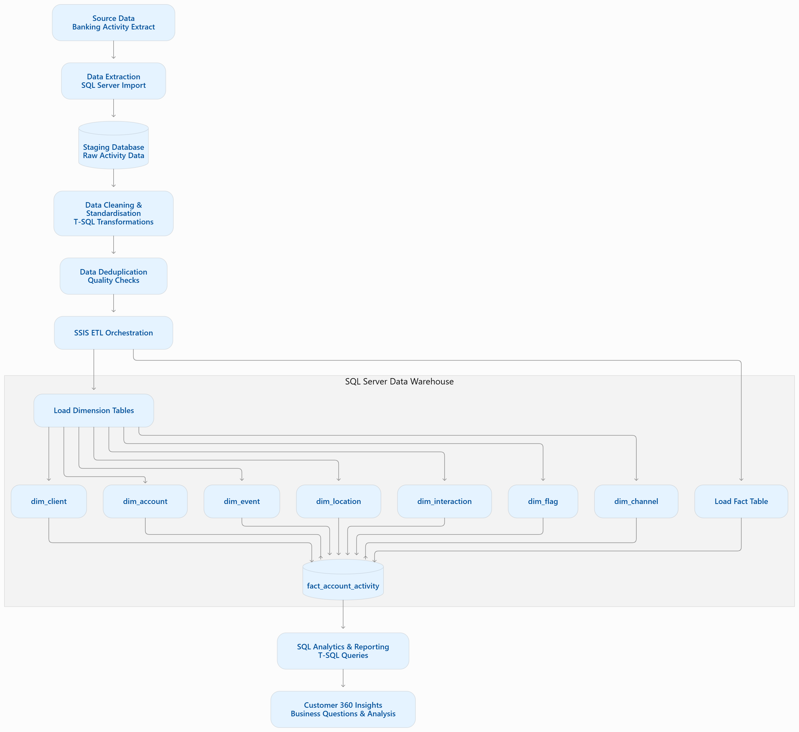

# Customer 360 Data Warehouse | Data Engineering Capstone

**A SQL Server and SSIS data engineering project focused on transforming raw banking activity data into a structured dimensional data warehouse for customer analytics and business intelligence.**


## 1. Project Overview

Customer data in operational systems is often stored in denormalized structures, making it difficult to perform consistent reporting and obtain a unified view of customer activity.

This project focuses on building a **Customer 360 Data Warehouse** for a fictional retail banking environment.

The objective is to transform a flat banking activity extract into a structured dimensional data warehouse using Microsoft SQL Server and SQL Server Integration Services (SSIS).

The solution involves extracting and staging source data, applying data-cleaning and deduplication logic, developing dimension and fact tables, and preparing the resulting warehouse for analytical queries.

The project demonstrates practical data engineering concepts, including:

- ETL pipeline development.
- Data cleaning and standardization.
- Data deduplication.
- Dimensional data modelling.
- Star schema design.
- Surrogate key management.
- Fact and dimension loading.
- SQL-based data analysis.
- Data quality and validation.

## Data Architecture




### Star Schema

The following diagram illustrates the warehouse structure.


*The diagram illustrates the central fact table and its relationships with the seven dimensions.*


## 2. Business Problem

The source banking activity data contains customer information, account details, transactions, geographical information and customer interactions within a denormalized dataset.

This structure presents several challenges:

- Customer information may be repeated across multiple records.
- Inconsistent formatting can affect data accuracy.
- Duplicate records can distort analytical results.
- Data is not structured optimally for analytical reporting.
- Customer and account activity can be difficult to analyse across business dimensions.

The project addresses these challenges by transforming the source data into a dimensional warehouse that provides a more organized foundation for customer analytics.

## 3. Project Objectives

The main objectives are to:

1. Extract and stage the source banking activity data.
2. Standardize inconsistent data formats.
3. Identify and handle duplicate records.
4. Design a dimensional warehouse using a star schema.
5. Create fact and dimension tables with appropriate keys and relationships.
6. Develop an SSIS ETL workflow to orchestrate data loading.
7. Use SQL to answer business questions relating to customer and account activity.
8. Establish data quality checks to improve the reliability of analytical outputs.

## 4. Technology Stack

| Technology | Purpose |
|---|---|
| Microsoft SQL Server | Database management and warehouse storage |
| SQL Server Management Studio (SSMS) | SQL development and database administration |
| SQL Server Integration Services (SSIS) | ETL development and workflow orchestration |
| T-SQL | Data extraction, transformation, loading and analysis |
| SQL Server Data Tools (SSDT) | SSIS package development |

## 5. Solution Architecture

The project follows an ETL-based data warehousing approach.

### High-level workflow

```text
       SOURCE DATA
    Banking Activity Extract
             |
             v
     DATA EXTRACTION
             |
             v
      STAGING DATABASE
             |
             v
    DATA TRANSFORMATION
   - Standardization
   - Data cleaning
   - Deduplication
   - Data validation
             |
             v
      DIMENSION LOADING
   - Client
   - Account
   - Event
   - Location
   - Interaction
   - Flag
   - Channel
             |
             v
        FACT LOADING
    Fact Account Activity
             |
             v
    CUSTOMER 360 WAREHOUSE
             |
             v
       SQL ANALYTICS
             |
             v
     BUSINESS INSIGHTS
```

The SSIS master package coordinates the ETL workflow, while SQL scripts implement database creation, transformations, dimensional loading and analytical queries.

## 6. Data Warehouse Design

The warehouse follows a dimensional modelling approach using a central fact table connected to descriptive dimension tables.

### Fact Table

**fact_account_activity**

The central fact table stores account activity information and connects the activity records to their associated dimensions through surrogate keys.

The fact table is designed to support analytical queries involving customer activity, account information and other business attributes.

The precise grain of the fact table should be interpreted according to the source activity records and documented business rules.

### Dimension Tables

| Dimension | Description |
|---|---|
| dim_client | Customer demographic and identifying information |
| dim_account | Account-related attributes |
| dim_event | Event-related attributes |
| dim_location | Geographical information |
| dim_interaction | Customer interaction attributes |
| dim_flag | Activity or customer flag attributes |
| dim_channel | Channel-related attributes |


## 7. ETL Pipeline

The ETL process is divided into several stages.

### Stage 1: Source Data Extraction

The banking activity extract serves as the source dataset.

The data is imported into the SQL Server staging environment before transformation.

### Stage 2: Data Staging

A staging database is used to hold the source data before it is transformed and loaded into the dimensional warehouse.

This separates the initial source data from the analytical data model.

### Stage 3: Data Cleaning and Standardization

SQL transformations are applied to improve data consistency.

Examples include:

- Removing leading and trailing whitespace.
- Standardizing text formatting.
- Converting values into appropriate formats.
- Handling missing values according to applicable rules.
- Preparing records for dimensional loading.

### Stage 4: Deduplication

Duplicate records are identified using selected business attributes.

The objective is to reduce duplicate data while preserving legitimate customer and account activity.

Deduplication rules should be aligned with the intended grain of the fact table.

### Stage 5: Dimension Loading

The dimension tables are populated from the cleaned staging data.

Surrogate keys are used to establish relationships between the dimensions and the fact table.

### Stage 6: Fact Loading

The fact table is populated by resolving the relevant dimension keys and loading the corresponding activity records.

### Stage 7: ETL Orchestration

An SSIS master package coordinates the execution of the ETL workflow.

This provides a structured approach to executing the individual loading and transformation operations.

## 8. Analytical SQL and Business Questions

SQL queries are developed to demonstrate how the dimensional warehouse can support business analysis.

The analytical questions include:

- How many customers are represented in each geographical province?
- What is the distribution of customers across different age groups?
- How many customer signups occur each month?
- Which banking products have the highest customer activity?
- What are the account activity trends across different product categories?
- Which customers have activity across multiple product categories?
- How does customer activity vary across different channels?

These queries demonstrate the application of SQL joins, aggregations, grouping, common table expressions, date functions and window functions where appropriate.

## 9. Data Quality and Validation

Data quality is an important consideration when transforming raw operational data into an analytical warehouse.

The project considers the following validation areas:

| Validation area | Purpose |
|---|---|
| Completeness | Identify missing or null values |
| Consistency | Check standardized formats |
| Uniqueness | Identify duplicate business records |
| Validity | Identify invalid or unexpected values |
| Referential integrity | Validate fact-to-dimension relationships |
| Reconciliation | Compare source and warehouse record counts |

Validation results should be recorded alongside the ETL execution results.

### Validation Results

| Metric | Result |
|---|---|
| Source records | 21500 rows |
| Records staged | 21500 rows |
| Duplicate records identified | 23 rows |
| Rejected records | 0 rows |
| Records loaded into fact table | 21477 rows |
| Unresolved dimension keys | None |


## 10. Repository Structure

```text
customer-360-data-warehouse/
│
├── README.md
│
├── SQL Scripts/
│   ├── Database Creation
│   ├── Data Extraction
│   ├── Data Standardization
│   ├── Data Deduplication
│   ├── Dimension Creation
│   ├── Dimension Loading
│   ├── Fact Loading
│   └── Questions and Answers
│
├── SSIS/
│   └── Customer 360 SSIS Project
│
├── Screenshots/
│   ├── Star Schema
│   ├── SQL Query Results
│   ├── Data Transformation
│   └── ETL Execution
│
└── Documentation/
    ├── Data Quality
    └── Project Documentation


## 11. How to Run the Project

### Prerequisites

Before executing the project, ensure you have:

- Microsoft SQL Server installed and running.
- SQL Server Management Studio (SSMS).
- SQL Server Integration Services development tools.
- Visual Studio with the appropriate SSIS extension.
- Access to the source banking activity extract.

### Execution Steps

**Step 1: Clone the repository**

```bash
git clone https://github.com/Buthodev/data-engineering-capstone-april-may-2026_ntando-main.git
```

**Step 2: Open SQL Server Management Studio**

Connect to your SQL Server instance.

**Step 3: Prepare the databases**

Execute the database creation scripts in the documented order to create the staging and warehouse databases.

**Step 4: Import the source dataset**

Import the banking activity extract into the expected staging source table.

Verify that the table and column names match those referenced in the SQL scripts.

**Step 5: Execute the transformation scripts**

Run the data standardization and deduplication scripts.

**Step 6: Create and populate the warehouse**

Execute the dimension creation and loading scripts before loading the fact table.

**Step 7: Execute the SSIS project**

Open the SSIS solution in Visual Studio, configure the database connection managers and execute the master package.

**Step 8: Validate the warehouse**

Run the data quality checks and analytical SQL queries to verify the loaded data.

*Note: Confirm the exact execution order and SSIS package configuration against the final implementation before treating these instructions as a verified deployment guide.*

## 12. Screenshots and Implementation Evidence

Screenshots are included in the repository to demonstrate the SQL development process, dimensional warehouse design, data transformations and ETL execution.

The evidence should include:

- Star schema and database relationships.
- SQL transformation queries.
- Dimension and fact table outputs.
- SSIS control flow.
- Successful ETL execution.
- Analytical query results.
- Data quality and reconciliation results.

## 13. Challenges and Engineering Considerations

The project provides practical exposure to several data engineering challenges:

- Working with denormalized source data.
- Handling inconsistent customer information.
- Designing meaningful deduplication rules.
- Maintaining relationships between fact and dimension tables.
- Managing surrogate keys during warehouse loading.
- Ensuring analytical queries produce accurate results.
- Making ETL operations repeatable and reliable.

These considerations highlight the importance of data quality, dimensional modelling and controlled data movement in building analytical data platforms.

## 14. Future Improvements

Potential extensions to strengthen the warehouse include:

- Implementing incremental ETL loading.
- Introducing Slowly Changing Dimensions (SCD Type 2) for historical customer tracking.
- Adding a dedicated date dimension.
- Implementing automated data quality tests.
- Adding detailed ETL execution and error logging.
- Improving pipeline recovery and rerun handling.
- Introducing a Power BI dashboard for customer analytics.
- Evaluating query performance and indexing strategies.
- Exploring cloud-based data warehousing and orchestration.

## 15. Project Outcomes and Learning

This project demonstrates the practical application of data engineering concepts using Microsoft SQL Server and SSIS.

It provides experience in:

- Developing ETL workflows.
- Transforming raw operational data.
- Designing dimensional data models.
- Implementing fact and dimension tables.
- Writing analytical SQL queries.
- Understanding data quality and warehouse reliability.

It also provides a foundation for further development in enterprise data warehousing, analytics engineering and cloud-based data engineering.