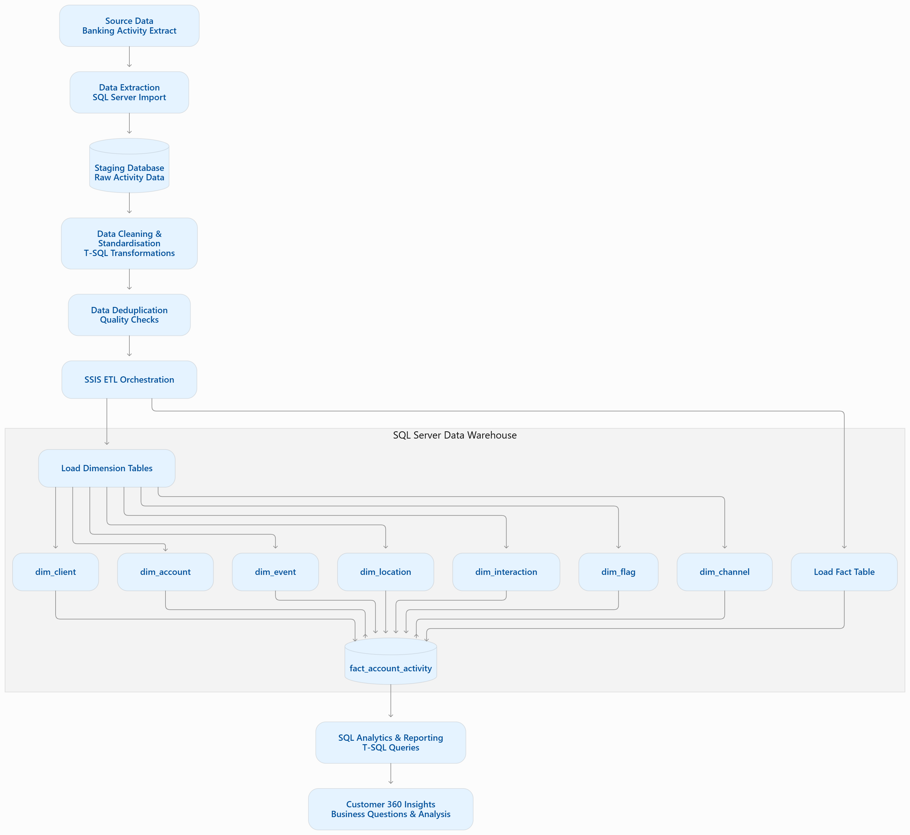

# Customer 360 Data Warehouse | Data Engineering Capstone

**Author:** Ntando  
**GitHub:** [@Buthodev](https://github.com/Buthodev)  


---

## 1. Project Overview

The Customer 360 Data Warehouse is a data engineering project that demonstrates how raw, denormalised banking activity data can be transformed into a structured dimensional data warehouse for analytical reporting.

The project uses **Microsoft SQL Server, T-SQL, SQL Server Management Studio (SSMS), and SQL Server Integration Services (SSIS)** to build an ETL workflow covering data extraction, staging, cleaning, deduplication, dimensional modelling and analytical querying.

The objective is to consolidate customer, account and banking activity information into a central warehouse that supports customer-level analysis and business decision-making.

## 2. Business Problem

Banking activity data can contain inconsistent formats, duplicate records, missing values and information spread across multiple business attributes.

Without a structured data warehouse, analysing customer behaviour, account activity, product usage and service interactions can be difficult and inconsistent.

This project addresses that challenge by creating a repeatable data preparation and warehouse-loading workflow.

## 3. Project Objectives

- Import raw banking activity data into SQL Server.
- Create a staging environment for raw and transformed data.
- Standardise inconsistent data formats and values.
- Identify and remove duplicate records according to the implemented deduplication logic.
- Design a dimensional data warehouse using a star-schema approach.
- Load dimension and fact tables using T-SQL and SSIS.
- Develop analytical SQL queries to answer business questions.
- Document the ETL architecture, data quality considerations and analytical outputs.

## 4. Technology Stack

| Technology | Purpose |
|---|---|
| Microsoft SQL Server | Database engine |
| SQL Server Management Studio (SSMS) | SQL development and database management |
| T-SQL | Database creation, transformation and warehouse loading |
| SQL Server Integration Services (SSIS) | ETL package orchestration |
| Visual Studio / SSIS extension | SSIS project development |
| GitHub | Version control and project documentation |

## 5. Data Architecture

The project follows a staged ETL architecture.



---

### Architecture explanation

1. **Source data:** Raw banking activity records are supplied as an input extract.
2. **Staging:** Source data is imported into the `stg_Customer360` SQL Server database.
3. **Transformation:** T-SQL scripts standardise and clean the staging data.
4. **Deduplication:** Duplicate records are identified and handled.
5. **ETL orchestration:** SSIS packages organise the staging, cleaning and warehouse-loading workflow.
6. **Data warehouse:** Dimension tables provide descriptive information, while the central fact table stores banking activity measures and dimension keys.
7. **Analytics:** SQL queries use the warehouse to investigate customer and account activity.

## 6. Data Warehouse Design

The warehouse database is named:

`Customer360_DW`

It contains one central fact table and seven dimension tables.

### Fact table

**`fact_account_activity`**

The fact table contains the following measures:

- `loan_amount`
- `credit_limit`
- `amount`
- `account_balance`

It also contains foreign keys linking activity records to the dimension tables.

The current table has an identity-based primary key named `activity_id`.

**Fact grain:** The intended grain is one record per source banking activity. The source activity identifier and the final duplicate-handling rules still need to be formally established to guarantee this grain.

### Dimension tables

| Dimension | Purpose |
|---|---|
| `dim_client` | Customer demographic and contact information |
| `dim_account` | Account number, product type, status and transaction type |
| `dim_event` | Event date and event type |
| `dim_location` | Customer activity location, city and province |
| `dim_interaction` | Interaction type |
| `dim_flag` | Resolution status |
| `dim_channel` | Channel used for the activity |

### Star schema

The dimensional model is illustrated below.


## 7. ETL Implementation

The project contains nine numbered SQL scripts and four SSIS packages.

### 7.1 SQL scripts

The following scripts are included in the `Project Files` directory.

| Script | Description |
|---|---|
| `01.create_staging_database.sql` | Creates the staging database and schema |
| `02.create_staging_tables.sql` | Creates the staging table |
| `03.load_raw_data_to_staging.sql` | Loads raw data into staging |
| `04.standardise column formatting.sql` | Standardises data formats and values |
| `05.dedupication of data in staging table.sql` | Identifies and removes duplicate records |
| `06.create data warehouse database and schema.sql` | Creates the warehouse database and schema |
| `07.create dw tables.sql` | Creates the dimension and fact tables |
| `08.load data from staging table into dw dim tables.sql` | Loads the dimension tables |
| `09.load data from staging table into dw fact table.sql` | Loads the fact table |

### 7.2 SSIS packages

The SSIS project is located in:

`Project Files/capstone_etl/`

It contains four packages:

| Package | Purpose |
|---|---|
| `Master Package.dtsx` | Coordinates the ETL workflow |
| `Staging Package.dtsx` | Handles staging database preparation, data loading and standardisation |
| `Dedup and Clean.dtsx` | Handles the deduplication and cleaning stage |
| `DW Loading.dtsx` | Handles warehouse creation and dimension/fact loading |

The master package provides the overall orchestration structure, with separate packages for the main ETL stages.

**Note:** The packages and their execution dependencies should be tested in the target SQL Server and SSIS environment before the workflow is described as fully automated or production-ready.

## 8. Data Quality and Cleaning

The project includes a data quality assessment documented in:

`Project Files/Data Quality.txt`

The data preparation work considers issues such as:

- Missing customer information.
- Inconsistent text formatting.
- Duplicate records.
- Incorrect or inconsistent values.
- Data standardisation requirements.

The SQL scripts include transformations intended to improve data consistency before warehouse loading.

### Data quality considerations

The following checks should be used to assess the quality of the final warehouse:

| Validation area | Validation objective |
|---|---|
| Completeness | Identify missing values in required fields |
| Uniqueness | Identify duplicate customer and activity records |
| Consistency | Check standardised text and date formats |
| Referential integrity | Confirm fact records reference valid dimension records |
| Reconciliation | Compare source, staging, rejected and warehouse record counts |
| Rerun safety | Confirm that repeated ETL execution does not create unintended duplicates |

### Validation status

The repository contains SQL transformation scripts, data quality documentation and analytical query screenshots.

However, complete execution-based validation results, including reconciled source-to-target counts, unresolved dimension keys and repeat-run testing, have not yet been established in this documentation.

These results should be populated after running the pipeline and its validation queries.

| Metric | Result |
|---|---|
| Source records | To be measured |
| Staging records | To be measured |
| Duplicate records identified | To be measured |
| Rejected records | To be measured |
| Dimension records loaded | To be measured |
| Fact records loaded | To be measured |
| Unmatched dimension keys | To be measured |
| Reconciliation difference | To be measured |

## 9. Business Questions and Analytical SQL

The project includes a collection of 20 numbered analytical questions in:

`Project Files/Questions and Answers.sql`

The queries explore customer, account and banking activity information.

The analysis includes topics such as:

- Customer distribution by province.
- Customer age distribution.
- Monthly customer signups.
- Customer data quality.
- Product and account activity.
- Banking transaction and interaction patterns.
- Customer activity and account balances.

The SQL queries are supported by screenshots stored in:

`Project Files/Customer_360_Screenshots/`

These screenshots provide visual evidence of selected query outputs.

**Important:** Analytical results should be interpreted using clearly defined metric rules. For example, account balances should not be summed across repeated transaction-level records unless the data model and reporting logic justify doing so.

## 10. Repository Structure

The project files are organised as follows:

```text
data-engineering-capstone-april-may-2026_ntando-main/
│
├── README.md
│
└── Project Files/
    │
    ├── 01.create_staging_database.sql
    ├── 02.create_staging_tables.sql
    ├── 03.load_raw_data_to_staging.sql
    ├── 04.standardise column formatting.sql
    ├── 05.dedupication of data in staging table.sql
    ├── 06.create data warehouse database and schema.sql
    ├── 07.create dw tables.sql
    ├── 08.load data from staging table into dw dim tables.sql
    ├── 09.load data from staging table into dw fact table.sql
    │
    ├── capstone_etl/
    │   ├── Master Package.dtsx
    │   ├── Staging Package.dtsx
    │   ├── Dedup and Clean.dtsx
    │   ├── DW Loading.dtsx
    │   ├── capstone_etl.dtproj
    │   └── capstone_etl.slnx
    │
    ├── Customer360Capstone Star Schema v3.png
    ├── Customer360Capstone Star Schema v3.pdf
    ├── Data Quality.txt
    ├── Questions and Answers.sql
    │
    ├── Customer_360_Screenshots/
    │
    └── ETL Package Screenshots/
```

## 11. How to Run the Project

### Prerequisites

Before running the project, ensure that you have:

- Microsoft SQL Server installed and accessible.
- SQL Server Management Studio (SSMS).
- Visual Studio with the appropriate SQL Server Integration Services extension.
- Access to the original banking activity extract.
- Permissions to create databases, schemas and tables.

### Step 1: Clone the repository

```bash
git clone https://github.com/Buthodev/data-engineering-capstone-april-may-2026_ntando-main.git
```

Open the repository in your preferred development environment.

### Step 2: Prepare the source data

The raw source extract must be available before running the data-loading process.

Review `03.load_raw_data_to_staging.sql` and confirm the expected source table, columns and import method.

The source extract itself must be supplied separately if it is not included in the repository.

### Step 3: Prepare the staging database

Open SSMS and execute the staging setup and loading scripts in the appropriate order:

1. `01.create_staging_database.sql`
2. `02.create_staging_tables.sql`
3. `03.load_raw_data_to_staging.sql`

Confirm that the staging table contains the expected source records.

### Step 4: Clean and transform the staging data

Execute:

4. `04.standardise column formatting.sql`
5. `05.dedupication of data in staging table.sql`

Review the transformation results and check for missing values, inconsistent formatting and duplicates.

### Step 5: Create the data warehouse

Execute:

6. `06.create data warehouse database and schema.sql`
7. `07.create dw tables.sql`

Confirm that the warehouse tables have been created successfully.

### Step 6: Load dimensions and facts

Execute:

8. `08.load data from staging table into dw dim tables.sql`
9. `09.load data from staging table into dw fact table.sql`

Dimensions should be populated before the fact table because the fact table references dimension keys.

### Step 7: Explore the SSIS project

Open:

`Project Files/capstone_etl/capstone_etl.slnx`

Review the master package and its component packages.

Configure connection managers and environment-specific parameters before execution.

The SQL scripts and SSIS packages provide related implementation paths. Avoid running both loading approaches against the same populated warehouse without first defining the intended load strategy.

### Step 8: Run analytical queries

Open:

`Project Files/Questions and Answers.sql`

Execute the analytical queries against the completed warehouse and compare the results with the documented screenshots.

## 12. Challenges and Technical Considerations

The project highlights several important data engineering challenges:

- Preparing inconsistent source data for analytical use.
- Identifying and handling duplicate records.
- Designing dimensions and a central fact table.
- Maintaining correct relationships between fact and dimension records.
- Coordinating multiple ETL stages through SSIS.
- Defining appropriate measures and analytical calculations.
- Ensuring repeatable and reliable data loading.

These considerations also identify areas for further improvement, particularly around fact grain, dimension business keys, unmatched records and repeatable loading.

## 13. Future Improvements

The following improvements are planned or recommended:

- Implement a fully idempotent incremental loading strategy.
- Define and enforce dimension business-key uniqueness.
- Introduce a dedicated date dimension.
- Implement explicit unknown dimension members.
- Add source-to-target reconciliation and automated data quality checks.
- Add ETL execution logging, error handling and recovery.
- Define slowly changing dimension (SCD) requirements.
- Improve indexing and query performance.
- Develop a Power BI dashboard for business reporting.
- Explore cloud-based data warehousing and orchestration as a later enhancement.

These are improvement opportunities and should not be interpreted as already implemented functionality.

## 14. Project Learning Outcomes

Through this project, I developed practical experience in:

- SQL Server database development.
- Writing T-SQL data transformation scripts.
- Staging raw data for analytical processing.
- Data cleaning and deduplication.
- Dimensional data modelling.
- Fact and dimension table design.
- SSIS package development and orchestration.
- Analytical SQL query development.
- Documenting a data engineering workflow.

## 15. Project Links

- [GitHub Repository](https://github.com/Buthodev/data-engineering-capstone-april-may-2026_ntando-main)
- [Project Files](https://github.com/Buthodev/data-engineering-capstone-april-may-2026_ntando-main/tree/main/Project%20Files)

---

**Author:** Ntando Ndwandwe 
**GitHub:** [@Buthodev](https://github.com/Buthodev)
